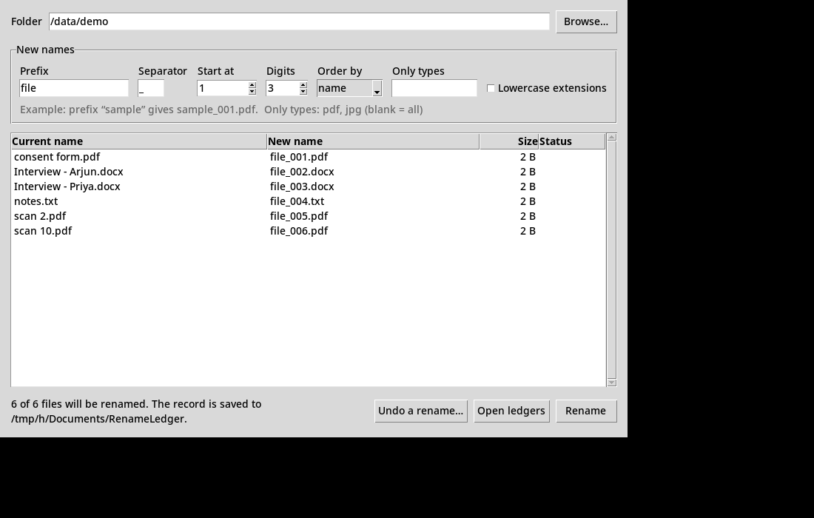

# RenameLedger

Batch-rename files on Windows **and keep a record of every change**.

Renaming 200 files to `sample_001.pdf`, `sample_002.pdf`… is easy. Knowing afterwards which file was
`Interview - Priya.docx` is not. RenameLedger saves a CSV that maps every old name to its new name,
and can undo the whole batch from that CSV.

Useful for anonymising research data, tidying scans and photos, or any rename you might need to trace later.



## Use it on Windows

**Option A: the .exe (no Python needed)**
Download `RenameLedger.exe` from the [Releases](../../releases) page and double-click it.

**Option B: from this folder**
1. Install Python 3.9+ from [python.org](https://www.python.org/downloads/) if you don't have it.
2. Double-click **`RenameLedger.bat`**.

## How it works

1. **Browse…** to a folder.
2. Type a prefix. The table shows the new names as you type.
3. Click **Rename** and confirm.
4. The record is saved in `Documents\RenameLedger\` as a CSV you can open in Excel.

To undo, click **Undo a rename…**, pick the record, check the preview and click **Restore names**.

### Safety

- Nothing is renamed until you confirm. Existing files are never overwritten.
- If one rename fails (for example, a file is open in another program), the batch is rolled back.
- Files are renamed in two steps (old → temporary → new), so swaps and re-runs on renamed files work.
- Ignores sub-folders, `desktop.ini` and `Thumbs.db`. Files are sorted naturally (`scan 2` before `scan 10`).
- The record is kept **outside** the renamed folder because it contains the original names.
  If those names are sensitive, protect the record or delete it.

## Command line

```
pip install .
renameledger preview "D:\study\interviews" --prefix sample
renameledger rename  "D:\study\interviews" --prefix sample --ext docx,pdf
renameledger undo    "%USERPROFILE%\Documents\RenameLedger\interviews_2026-11-03_161500_ab12cd34.csv"
```

Options: `--start`, `--digits`, `--separator`, `--ext`, `--sort name|modified`, `--lowercase-ext`,
`--ledger PATH`, `-y` (skip confirmation). Run `renameledger` with no arguments to open the window.

## Record format

| batch_id | timestamp | folder | old_name | new_name | size_bytes | status |
|---|---|---|---|---|---|---|
| ab12cd34 | 2026-11-03T16:15:00 | D:\study\interviews | Interview - Priya.docx | sample_003.docx | 18211 | renamed |

`status` is `renamed`, `unchanged`, `failed`, or `pending` (only seen if the app was killed mid-rename).

## Development

```
python -m unittest discover -s tests -v
build-exe.bat          # creates dist\RenameLedger.exe with PyInstaller
```

Pushing a tag such as `v1.0.0` makes GitHub Actions run the tests on Windows, build the .exe and attach
it to a release.

No dependencies beyond the Python standard library.

## License

MIT
