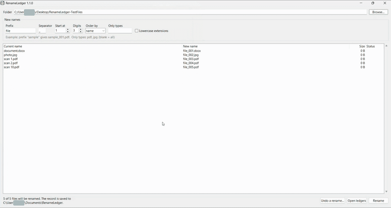
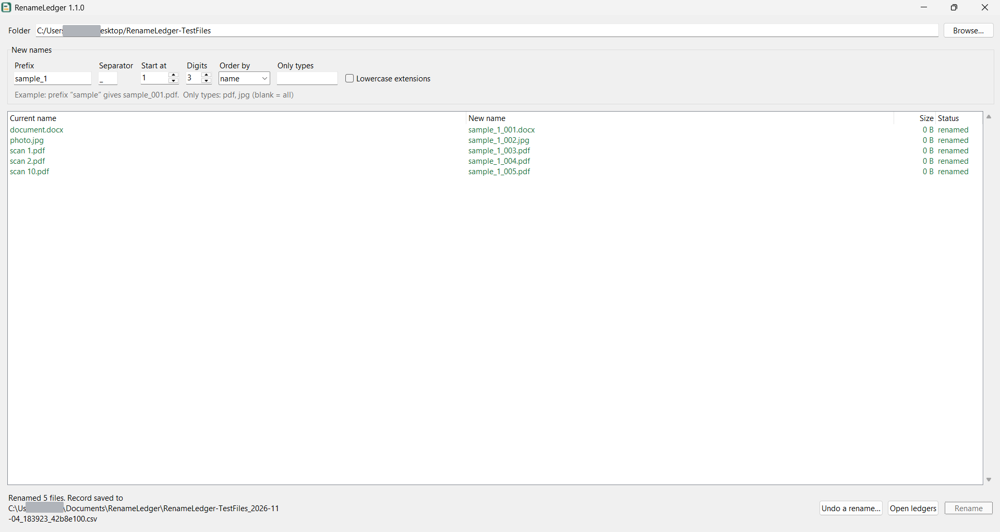
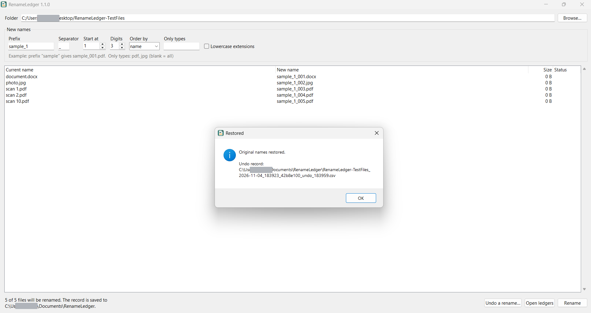

<div align="center">
  
  <h1>RenameLedger</h1>
  <p>Batch-rename files and keep a record of every change.</p>
  <p>
    
    
    
    <a href="https://github.com/saoud30/RenameLedger/releases/tag/v1.0.1"></a>
  </p>
</div>

RenameLedger gives files consistent names while saving the original-to-new mapping in a CSV. Review the names before committing, and use the record to restore them later.



## Features

- Live preview of names before you confirm a batch.
- Numbered names with a configurable prefix, separator, starting number and digit width.
- Optionally include nested subfolders while keeping files in their original directories.
- Filter by file extension; sort by name or modification time.
- CSV records and a restore preview for undoing completed renames.
- Collision checks, two-step renaming and rollback on rename errors.
- A responsive graphical window with progress feedback, plus a command-line interface.

## Screenshots



*The main window after renaming five files.*



*The confirmation after restoring the original names.*

These captures show an earlier 1.1.0 development build; personal path details have been obscured. They do not show the newer subfolder and progress controls. The downloadable v1.0.1 release does not include the newer features documented below.

## Download and install

### Windows executable (no Python required)

Download **RenameLedger.exe** from the [v1.0.1 release](https://github.com/saoud30/RenameLedger/releases/tag/v1.0.1), then double-click it.

### Run from the project folder

1. Install [Python 3.9 or later](https://www.python.org/downloads/), including the Python launcher or adding Python to PATH.
2. Download or clone this repository.
3. Double-click `RenameLedger.bat` in the project folder.

### Install from source

From PowerShell in the project folder:

```powershell
py -m pip install .
renameledger
```

Running `renameledger` without arguments opens the window. The installed package also provides the `renameledger-gui` command.

## Rename files

1. Open RenameLedger and select a folder with **Browse…**.
2. Enter a **Prefix**. Adjust the separator, starting number and digits if needed. For example, `sample` with the default settings produces `sample_001.pdf`.
3. Optionally choose the order, enter file types such as `pdf,jpg`, select **Lowercase extensions**, or select **Include subfolders** beneath the name options. The default is the selected folder only; the status line shows the active scope.
4. Review the current and proposed paths in the table. The Rename button becomes available once the complete preview has loaded.
5. Select **Rename** and confirm. Progress shows processed and remaining files. When complete, the window shows the record location; **Open ledgers** opens the records folder.

## Records and restore

By default, CSV records are saved in `Documents\RenameLedger`, outside the folder being renamed. Each row records the batch ID, timestamp, root folder, old name, new name, size and status. For subfolder batches, the names are paths relative to the root (for example `scans/old.pdf` → `scans/sample_001.pdf`). The CSV uses UTF-8 with a BOM so it opens in Excel. Keep the record safe: it contains the original names and folder path.

To restore names:

1. Select **Undo a rename…** and choose the original batch CSV.
2. Review the root folder and restore preview. Missing files or folders are marked and skipped. Conflicting destinations are marked and must be resolved before restoring. Press **Esc** to cancel.
3. Select **Restore names** and confirm. A separate `_undo_HHMMSS_<id>.csv` record is saved alongside the original.

Older v1.0.1 filename-only records remain readable. Use this newer build to restore recursive records; do not rely on an older executable for them.

The record is written before renaming starts. A `pending` status can indicate an interrupted operation or incomplete rollback; it cannot be automatically undone. Check the files, including temporary files, and the record carefully before taking further action. Keep backups of important files.

## Options and behavior

- Name sorting is natural: `scan 2` comes before `scan 10`. Modification-time sorting is also available.
- The type filter accepts comma-separated extensions, with or without a leading dot. Leave it blank to include all file types.
- By default only the selected folder is processed. With **Include subfolders**, eligible files in nested folders are included without renaming or moving directories. Numbering is global across the sorted batch; existing names are checked within each directory.
- `desktop.ini`, `Thumbs.db`, RenameLedger temporary files, and linked files and folders (including junctions) are skipped. Selecting a root within a linked folder is not supported.
- Existing items outside the batch are not overwritten; numbering skips their names. A final collision check runs before renaming.
- Files move through temporary names so swaps and case-only renames can work. If a rename fails, the app attempts to roll the batch back; a second error can make rollback incomplete. Check your files and ledger if an error or interruption occurs. Avoid moving files or changing links in the selected tree while an operation is running.

## Command line

```powershell
renameledger preview "D:\study\interviews" --prefix sample
renameledger rename "D:\study\interviews" --prefix sample --ext docx,pdf --recursive
renameledger undo "$env:USERPROFILE\Documents\RenameLedger\YOUR_RECORD.csv"
```

`preview` and `rename` accept `--start`, `--digits`, `--separator`, `--ext`, `--sort name|modified`, `--lowercase-ext` and `--recursive`. `rename` also accepts `--ledger PATH` to choose a new CSV location; an existing record is not overwritten. Use `-y` with `rename` or `undo` to skip confirmation. Run `renameledger --help` or `renameledger rename --help` for details.

## Requirements

- Windows for the packaged executable and batch launcher.
- Python 3.9+ with Tkinter for running from source or using the installed package. The application uses the Python standard library; building the executable requires PyInstaller.

## Troubleshooting

- **Windows SmartScreen warning:** If you trust the download and have verified its source, choose **More info** → **Run anyway**. Do not bypass a warning for an untrusted file.
- **Include subfolders is not visible:** Check that you are running the newly built `dist\RenameLedger.exe`, not an older downloaded executable. The v1.0.1 release does not include this option.
- **Python not found:** Install Python and its launcher, or add Python to PATH, then reopen the terminal or run the batch file again.
- **A file is open or a rename fails:** Close programs using the file and retry. The app attempts to roll back a failed batch; check the folder and CSV before retrying.
- **A file is missing during undo:** Restore it to the recorded folder under its renamed name, then load the original CSV again; otherwise it will be skipped.
- **A restore destination conflicts:** Move or rename the existing item, then load the original CSV again. RenameLedger does not overwrite it.
- **Antivirus flags the executable:** Packaged executables can trigger false positives, but do not assume a warning is harmless. Verify the download and scan it before deciding whether to run it; you can run from source instead.

## Contributing

Issues and pull requests are welcome. Run the tests from the project folder and, on Windows, build the executable with:

```powershell
py -m unittest discover -s tests -v
.\build-exe.bat
```

## License

[MIT](LICENSE)
